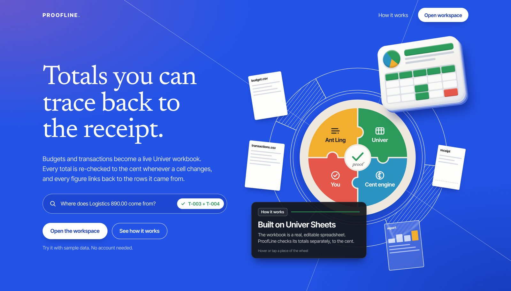
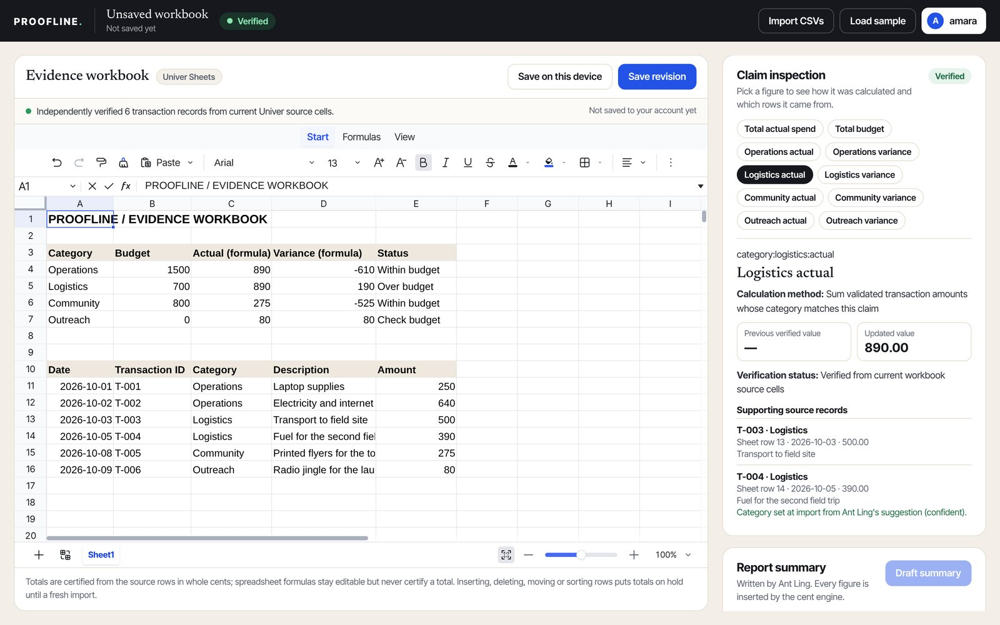
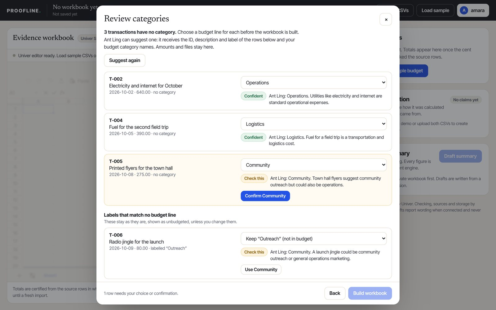
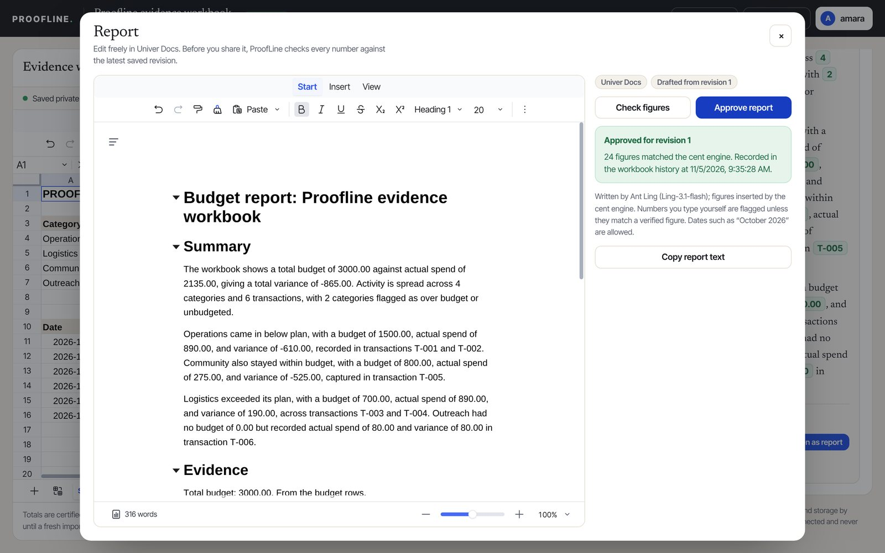
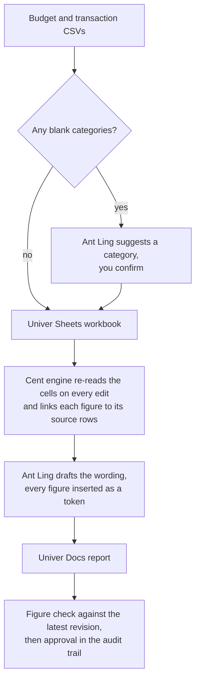

# ProofLine

<p align="center">
  <a href="https://proofline-alpha.vercel.app"></a>
</p>

<p align="center">
  <a href="https://proofline-alpha.vercel.app"></a>
  
  
  
</p>

ProofLine turns a budget and its transactions into a real, editable Univer spreadsheet:
- Ant Ling suggests categories for transactions that arrive without one, and you confirm them.
- ProofLine checks every total to the cent and shows the transactions behind each figure.
- Ant Ling writes the report in plain English, but it never supplies a number.
- Before a report can be approved, ProofLine checks each of its figures against the latest saved workbook.

**Live:** https://proofline-alpha.vercel.app (the workspace is at `/app`). It runs on free Vercel and Neon tiers, so please use the sample data or other made-up figures.

## See it

<p align="center"></p>
<p align="center"><sub>The workbook is a real Univer spreadsheet. Click any figure to see how it was calculated and which rows it came from, including how each category was chosen.</sub></p>

<table>
  <tr>
    <td width="50%"></td>
    <td width="50%"></td>
  </tr>
  <tr>
    <td><b>Ant Ling suggests, you confirm.</b> Three transactions arrive with no category. Ant Ling says where each belongs and how sure it is, and you confirm the unsure ones. It never sees an amount.</td>
    <td><b>A report you can approve.</b> The draft opens in Univer Docs. Type a number ProofLine didn't verify, or change a cell after drafting, and approval is refused until the figures match again.</td>
  </tr>
</table>

<sub>The screenshots come from a local build without the Univer licence; the live site also shows a Univer Budget vs actual chart. The suggestions and report wording in them are Ant Ling's own replies from the live site.</sub>

**Live check, 5 November 2026:** on the deployed site with the real Ant Ling key:
- Category suggestions were returned on the first try (445 tokens).
- The draft summary passed the number rule on the first try, with 24 figures inserted by the engine (960 tokens).
- Check figures matched 24 of 24, and the approval was recorded in the workbook history.

**Live check, 7 November 2026, after moving to Ling 3.2 Flash:** two runs, same sample data.
- Category suggestions came back on the first try both times (432–437 tokens).
- Both drafts passed the number rule on the first try (824–919 tokens), and both reports were checked and approved.

## Try it in two minutes

1. Open `/app`. **Load sample** shows the workbook straight away, with no account needed.
2. **Sign in** (create an account). Then choose **Import CSVs** → **Sample with blank categories** → **Suggest categories**.
   - Confident suggestions are filled in.
   - Uncertain ones wait for **Confirm**.
   - A label the file already gives, such as "Outreach", stays unless you choose **Use …**.

   Then choose **Build workbook**.
3. Click a category in **Verified totals**. The claim inspector shows the calculation and its source rows.
4. Change an amount in the sheet, for example cell E14 (T-004). The totals re-check, and the chart moves with them.
5. Choose **Save revision**, then **Draft summary**. Each figure in the draft is a chip that opens its claim.
6. Choose **Open as report** and edit the report in Univer Docs.
   - **Check figures** flags any number you typed, and any figure changed by a later save.
   - **Approve report** records the approval once every figure matches.

## How it works



- **Cent engine** (`lib/finance.ts`, `lib/verification.ts`): parses and validates the CSVs, then does all arithmetic in integer cents. Every claim carries its calculation and source transaction IDs. If an edit leaves the data invalid, the claim is withheld instead of guessed. Moving or deleting rows also withholds claims until the next clean import.
- **Server** (`lib/server/`, `app/api/`):
  - accounts and private, versioned workbook revisions, with conflict detection and retry-safe saves
  - an append-only audit trail
  - SQLite locally, PostgreSQL on Vercel
  - each saved snapshot is re-verified on the server
- **Category review** (`components/CategoryReview.tsx`, `lib/server/categorize.ts`):
  - A transactions file may leave the category blank. Those rows, plus labels that match no budget line, are reviewed before the workbook is built.
  - Ant Ling's suggestions are validated on the server: only real budget category names, only the IDs that were asked about, and short reasons.
  - A suggestion that would change a label the file already states is always marked "Check this". Nothing reaches the workbook until you choose it.
  - After the first save, the choices are checked against the saved revision and added to its history.
- **Report check** (`lib/server/report-check.ts`):
  - Every number in an edited report must be one of the following:
    - a current engine figure
    - a transaction date
    - a month or quarter with its year
    - part of the workbook title
  - A figure that has changed since the draft is reported as was → now.
  - Approval re-runs the check on the server and is refused for an older revision. It stores the text, its SHA-256 and the verified count.

## Univer

All packages are pinned to the same Univer release, 1.3.1. The separately versioned `@univerjs/icons` stays at 1.46.0, as Univer's own packages require.

| Use | Package | Facade API used |
|---|---|---|
| Editable workbook, formulas, edit events | `@univerjs/preset-sheets-core` | `createWorkbook`, `getRange().setValues/getValues/getFormulas`, `SheetValueChanged`, `CommandExecuted`, `FWorkbook.save()` |
| Budget vs actual chart (licensed) | `@univerjs/preset-sheets-advanced` | `newChart().setSource()…build()`, `insertChart` |
| Report editor | `@univerjs/preset-docs-core` | `createDocument`, `appendParagraph`, `setStyle` (named headings), `getParagraphs().getText()` |

The licensed preset loads only when `NEXT_PUBLIC_UNIVER_LICENSE` is set. That variable holds `license.txt`, which Univer designs to be sent to the browser. `licenseKey.txt` is a server secret and is not used or exposed.

## Ant Ling

Ant Ling (`Ling-3.2-flash` through Ant Ling's OpenAI-compatible API; `Ling-3.1-flash` until 7 November 2026) runs on the server for two jobs. It never supplies a number.

**Category suggestions.**
- It receives only the ID, description and current label of the rows under review, plus the budget category names. It never receives amounts or files.
- It answers in JSON with a category, a confidence and a short reason for each row.
- Anything outside the budget names or the rows asked about is dropped. A reply that is not valid JSON is retried once.

**Report wording.**
- It receives the verified totals, category names and transaction IDs. It does not receive your files or transaction descriptions.
- It must write every figure as a token such as `{{total:actual}}`. ProofLine replaces each token with the engine's value.
- A draft that contains any digit, percentage, currency sign or spelled-out number outside a token is rejected and retried once. If the retry fails too, no draft is shown.
- `GET /api/ai/status` reports whether drafting is configured, without revealing the key.

## Run locally

Requires Node 24 (`engines` in `package.json`). Local storage uses Node's built-in `node:sqlite`.

```bash
npm install
npm test          # 49 tests
npm run typecheck
npm run build
npm run dev       # http://localhost:3000, workspace at /app
```

Open the site as `http://localhost:3000`, not `127.0.0.1`: sign-in checks the request origin.

Without a database URL, data is stored in `.proofline-data/` (ignored by Git).

| Variable | Where | Purpose |
|---|---|---|
| `NEXT_PUBLIC_UNIVER_LICENSE` | browser, build time | Contents of Univer `license.txt`; turns on the chart. Redeploy after changing it. |
| `NEXT_PUBLIC_UNIVER_PRO_PREVIEW` | local only | Set to `1` to try licensed features without a license (Univer shows a watermark). |
| `ANT_LING_API_KEY` | server | Enables report drafting. |
| `ANT_LING_BASE_URL`, `ANT_LING_MODEL` | server, optional | Any OpenAI-compatible host serving Ling models. Defaults: `https://api.ant-ling.com/v1`, `Ling-3.2-flash`. |
| `DATABASE_URL` or `POSTGRES_URL` | server | PostgreSQL. Required on Vercel. |
| `PROOFLINE_DATA_DIR` | server, optional | Folder for the local SQLite file. |

`.env.example` lists them all. Never commit real values.

## Limits

These are the honest gaps today:

- **Input:** only CSV with the template columns in `data/`. There is no XLSX, PDF or receipt import.
- **Categories:** Ant Ling suggests from the budget's own category names only. It does not learn from earlier choices, and it reviews up to 40 rows per request.
- **Reports:**
  - The approved report is kept in the audit trail and can be copied. It is not saved as its own document.
  - There is no Slides output.
- **Not yet done:**
  - backup and restore of the hosted database
  - an external security review

## Repository guide

- `components/Workspace.tsx`: the `/app` workspace. `UniverPanel.tsx` holds the sheet, `CategoryReview.tsx` the import review and `ReportEditor.tsx` the Docs report.
- `components/landing/`: the landing page at `/`.
- `tests/`: unit tests, run with Node's test runner.
- `docs/BUILD_LEDGER.md`: dated log of every question, issue, decision and milestone, with the commands run and their results.
- `docs/CONTRIBUTION_MAP.md`: what was built with Univer and Ant Ling, and what is proven versus planned.
- `docs/evidence/`: screenshots referenced by the ledger.
- `AGENTS.md`: rules for coding agents working in this repo.

## References

- Univer with Next.js: https://docs.univer.ai/guides/sheets/getting-started/integrations/nextjs
- Univer licensing: https://docs.univer.ai/guides/server-integration/license
- Univer SDK skills: https://github.com/dream-num/skills
- Ant Ling open platform: https://chat.ant-ling.com/open
